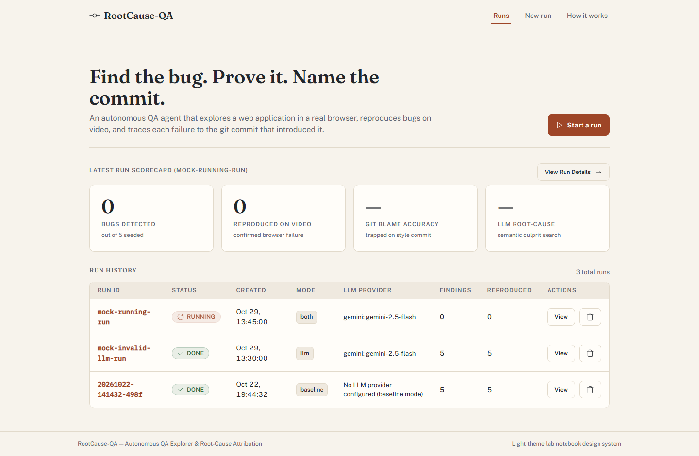

# RootCause-QA

Autonomous end-to-end web QA explorer that crawls routes, reproduces errors on video, and identifies culprit git commits through blame analysis and LLM reasoning.



## Pipeline

`crawl -> probe and fuzz -> reproduce on video -> root-cause (git blame, log -L) -> report and benchmark`

```text
[ Seed Repo ] -> [ Launch App ] -> [ Autonomous Explorer ] -> [ Playwright Video Repro ]
                                                                        |
                                                                        v
[ Benchmark Score ] <-- [ Markdown Report ] <-- [ Git Blame / LLM Root-Cause Analysis ]
```

## Quick Start

### Windows PowerShell

```powershell
# 1. Create and activate a virtual environment
python -m venv .venv
.\.venv\Scripts\Activate.ps1

# 2. Install dependencies and browser binaries
pip install -r requirements.txt
python -m playwright install chromium

# 3. Run the autonomous CLI baseline pipeline
python run_pipeline.py --reseed --rca baseline

# 4. Start the interactive web dashboard server
python run_server.py
```

### macOS / Linux

```bash
# 1. Create and activate a virtual environment
python3 -m venv .venv
source .venv/bin/activate

# 2. Install dependencies and browser binaries
pip install -r requirements.txt
python -m playwright install chromium

# 3. Run the autonomous CLI baseline pipeline
python run_pipeline.py --reseed --rca baseline

# 4. Start the interactive web dashboard server
python run_server.py
```

Open `http://127.0.0.1:8000/` in your browser to inspect runs, video artifacts, commit blame diffs, and benchmark scores (configured via `host = "127.0.0.1"` and default `port = 8000` in `run_server.py`).

### Run the Tests

Execute the automated test suite with pytest:

```powershell
# Run the fast test suite (27 unit and acceptance tests, no network or API keys needed)
pytest -q -m "not slow"

# Run the slow integration test (1 test, executes the full pipeline end-to-end)
pytest -q -m slow
```

## Enabling an LLM

RootCause-QA includes a multi-provider client with built-in retry backoff on HTTP 429/503 status codes. The pipeline runner supports four `--rca` analysis modes via `run_pipeline.py`:
- `--rca auto` *(default)*: Runs baseline blame analysis, and also runs LLM reasoning if an LLM provider is detected.
- `--rca baseline`: Runs deterministic line-level git blame analysis only.
- `--rca llm`: Runs LLM-powered root-cause reasoning only (requires a configured provider).
- `--rca both`: Runs both baseline git blame and LLM reasoning side-by-side for comparative benchmarking.

To enable LLM reasoning, set the corresponding API key or local provider environment variable:

| Provider | Key Variable | Default Model | Base URL |
|---|---|---|---|
| **Gemini** | `GEMINI_API_KEY` | `gemini-2.5-flash` | `https://generativelanguage.googleapis.com/v1beta/openai` |
| **Groq** | `GROQ_API_KEY` | `llama-3.3-70b-versatile` | `https://api.groq.com/openai/v1` |
| **OpenRouter** | `OPENROUTER_API_KEY` | `meta-llama/llama-3.3-70b-instruct:free` | `https://openrouter.ai/api/v1` |
| **Ollama** | *(none required)* | `llama3.1` | `http://localhost:11434/v1` |
| **Anthropic** | `ANTHROPIC_API_KEY` | `claude-sonnet-5-5` | `https://api.anthropic.com/v1` |

> **Note on Model Names:** Foundation model names evolve continuously. Set the `LLM_MODEL` environment variable (e.g., `export LLM_MODEL="llama-3.3-70b-versatile"`) to override any preset default model. For local inference with Ollama, set `LLM_PROVIDER=ollama`.

When executing an LLM-assisted run (`--rca llm` or `--rca both`), RootCause-QA enforces strict benchmark integrity: if an LLM call fails due to quota limits, network timeouts, or malformed JSON, the LLM mode is flagged as **INVALID** with the exact error message preserved. It is never reported as a measured `0/5` score.

## How Each Stage Works

### 1. Seed Repository
Initializes a clean, reproducible 10-commit git repository representing the historical development of a target web application ("Mini Shop"). Across these 10 commits, 5 real-world defect patterns are committed alongside simulated author identities and timestamps, and a ground-truth registry (`ground_truth.json`) is generated.

### 2. Test Application Server
Spawns the target Flask application on an isolated local port (`5055`), redirecting both standard output and error streams to a structured log file (`server.log`). The pipeline continuously polls the HTTP health endpoint until the server is fully ready before initiating automated exploration.

### 3. Crawl, Probe, and Fuzz
The autonomous QA agent scans the application beginning at the index route. It extracts interactive hyperlinks, mutates dynamic URL segments (e.g., testing `0`, `-1`, and out-of-range IDs), and submits boundary values, special characters, and SQL injection probes across discovered input forms to uncover unhandled exceptions.

### 4. Video Reproduction
For every finding that produced an unhandled HTTP 500 error, Playwright launches a dedicated headless Chromium context with video recording enabled. It executes the exact input steps required to trigger the crash, saving full-motion WebM video artifacts and browser console logs to provide irrefutable proof of reproduction.

### 5. Root-Cause Analysis (RCA)
Parses Python server exception tracebacks from application logs to extract the precise failing source file, line number, and function call. It executes `git blame` on the offending line and retrieves detailed surrounding commit history via `git log -L`. If configured, evidence is structured into a prompt for LLM evaluation.

### 6. Report and Benchmark
Compiles all forensic data into an executive markdown summary (`report.md`) detailing each finding, reproduction status, stack trace, and proposed git fix. The benchmark module (`benchmark.md`) matches attributed commit hashes against ground truth to score culprit identification accuracy.

## The Blame Trap Explained

Standard line-based git blame attributes a line of code to the most recent commit that modified it on disk. In real-world software development, code formatters, linter updates, and cosmetic refactors frequently touch lines without modifying their logical behavior. This creates a deceptive **blame trap**.

In RootCause-QA, Bug B4 on route `/search` demonstrates this phenomenon:
- **Culprit Commit:** `feat: let search match substrings` introduced unescaped string formatting directly into an SQL query string, opening an unhandled syntax error vulnerability on queries containing quotes.
- **Masking Commit:** A subsequent formatting commit, `style: wrap long SQL line`, broke the long query line across multiple lines for readability without altering execution logic.

When standard `git blame` is run on the failing query execution line, it attributes the line directly to the cosmetic formatting commit (`style: wrap long SQL line`), missing the true regression commit. A human developer or an advanced AST/LLM analyzer inspecting line history (`git log -L`) can look beyond the cosmetic edit to identify the earlier feature commit that introduced the flaw.

## Benchmark Results

Evaluation results from an automated baseline pipeline execution against the seeded ground truth:

- **Bugs Detected:** 5/5 (100%)
- **Bugs Reproduced on Video:** 5/5 (100%)
- **Baseline Git Blame Accuracy:** 4/5 (80%)
- **LLM Accuracy:** not measured yet *(run with `--rca both` using an API key or local Ollama instance)*

| Bug ID | Route | Exception | Culprit Commit Subject | Detected | Reproduced | Baseline Git Blame | LLM Reasoning |
|---|---|---|---|---|---|---|---|
| `B1` | `/discount` | `KeyError` | `feat: normalise discount codes` | Yes | Yes | `CORRECT` | not measured yet |
| `B2` | `/profile/<n>` | `KeyError` | `perf: skip redundant user lookup in profile` | Yes | Yes | `CORRECT` | not measured yet |
| `B3` | `/checkout` | `ZeroDivisionError` | `refactor: simplify checkout summary` | Yes | Yes | `CORRECT` | not measured yet |
| `B4` | `/search` | `OperationalError` | `feat: let search match substrings` | Yes | Yes | `MISS` (blame-trap) | not measured yet |
| `B5` | `/cart/add` | `ValueError` | `cleanup: drop redundant try/except in cart add` | Yes | Yes | `CORRECT` | not measured yet |

## Limitations

RootCause-QA is built as a transparent, reproducible benchmark and research prototype with the following constraints:
- **Toy Web Application:** Evaluated against Mini Shop, a compact Flask and SQLite web application designed to isolate and benchmark regression patterns cleanly.
- **Crash-Oriented Discovery:** The automated explorer identifies bugs triggered by unhandled HTTP 500 server errors; visual layout shifts, client-side accessibility regressions, and silent logical errors without server exceptions are not currently detected.
- **Line-Level Baseline:** Baseline root-cause analysis relies on standard line-level git blame, which fails on cosmetic refactorings (such as bug B4).
- **LLM root-cause analysis not measured yet:** Exploration is rule-based (crawling routes, mutating URL parameters, and submitting static boundary payloads) rather than LLM-driven. The LLM root-cause analysis integration is fully tested against local mock servers and unit tests, but production LLM reasoning accuracy has not yet been measured with live API keys on this benchmark.
- **Specific Tested Viewports:** The visual dashboard interface has been validated against real Chromium browser sessions at fixed breakpoints (1440px, 1024px, 768px, and 390px).

## Roadmap

- **Automated Fix Verification:** Automatically test proposed patch diffs by applying them to a working tree branch and replaying the reproduction video script.
- **AST-Aware Git Blame:** Replace line-level diff tracking with Abstract Syntax Tree (AST) node tracking to trace semantic changes through whitespace and formatting updates.
- **LLM-Driven Exploration:** Transition from rule-based form fuzzing to autonomous LLM-guided agent exploration capable of completing complex multi-step workflows.
- **Real-World Open-Source Evaluation:** Expand the benchmark harness to test against historical regressions in popular open-source repositories (Django, FastAPI, Flask).
- **Continuous Integration (CI):** Provide reusable GitHub Actions workflows to run automated exploration and blame analysis against pull requests.

## Troubleshooting

| Symptom | Cause | Fix |
|---|---|---|
| `Activate.ps1 cannot be loaded because running scripts is disabled` | Windows PowerShell execution policy blocks unsigned local scripts by default. | Run `Set-ExecutionPolicy -ExecutionPolicy RemoteSigned -Scope CurrentUser` in PowerShell. |
| `FileNotFoundError` or missing repo paths on Windows | Windows OneDrive folder redirection moved Desktop to `OneDrive\Desktop`. | Ensure you are in the actual workspace directory where the project resides. |
| `'python' is not recognized as an internal or external command` | Python was installed without the "Add Python to PATH" option selected. | Re-run the Python installer and check "Add python.exe to PATH", or invoke via `py`. |
| `git: command not found` | Git is not installed or not available in the system PATH. | Install Git from [git-scm.com](https://git-scm.com/) and restart your terminal. |
| `playwright._impl._errors.Error: Executable doesn't exist at ...` | Chromium browser binaries were not downloaded after installing Playwright. | Run `python -m playwright install chromium` in your activated virtual environment. |
| `RuntimeError: Test application failed to respond on port 5055` | Port 5055 or server port 8000 is occupied by an orphaned background process. | Identify the process using `netstat -ano \| findstr :5055` and terminate it with `taskkill /PID <PID> /F`. |
| `UnicodeEncodeError: 'charmap' codec can't encode character` | Windows console code page defaults to legacy ANSI (e.g., cp1252) when UTF-8 mode is off. | Set `$env:PYTHONUTF8="1"` in PowerShell or `set PYTHONUTF8=1` in cmd before running scripts. |
| `PermissionError: [WinError 5] Access is denied` when deleting `.git` | Git objects on Windows often have the read-only file attribute set. | Use the project's built-in `safe_rmtree` utility, which clears read-only attributes before deletion. |
